# 제1사건 — 옹고집전

> 담당: SO0omin · 최종 갱신: 2026-10-17
> 단서표 · 장계 정답: [제1사건_옹고집_단서표](제1사건_옹고집_단서표.md)

<!-- 대표 그림: 깨끗한 한 장이 생기면 주석을 푼다
<p align="center">
  
</p>
-->

옹씨 집에 옹덕구가 둘 있다. 집 안에서 주인 노릇을 하는 사내와, 담 밖에서 「내가 진짜」라고 외치는 사내.
마을은 담 밖 사내를 미쳐 버린 죽은 종이라 부른다.

플레이어는 신분을 숨긴 어사다. **밤에는 나그네로 그 집에 묵으며 몰래 뒤지고, 아침에는 마패를 꺼내
관아에서 공개로 조사한다.** 마지막에 장계를 써서 판결을 올린다.

<details>
<summary><b>진상 (스포일러)</b></summary>

설화 「옹고집전」은 가짜가 진짜를 내쫓는 이야기다. 이 사건은 그것을 뒤집는다.

| | |
|---|---|
| 甲 (주인 노릇을 하는 자) | 실은 이 집의 종 **복동**. 乙의 이복 아우다 |
| 乙 (담 밖의 성난 사내) | 진짜 **옹덕구**. 다만 연 10할 **갑리**를 놓아 고을을 괴롭혔다 |
| 복동의 신분 | 이미 **면천**된 몸이었는데, 관아 입안대장이 긁혀 고쳐져 종으로 남았다 |

깨끗한 쪽이 없다. 그래서 누가 진짜인지 맞히는 것만으로 끝나지 않고, **어떻게 처결할지**가 판결의 무게를 가진다.
</details>

---

## 흐름

```
조사청 ─▶ 1막 · 밤 (옹씨댁) ─▶ 출도 / 붙들림 ─▶ 2막 · 아침 (관아) ─▶ 장계 ─▶ 조사청
```

### 1막 · 밤 — 옹씨댁

<p align="center">
  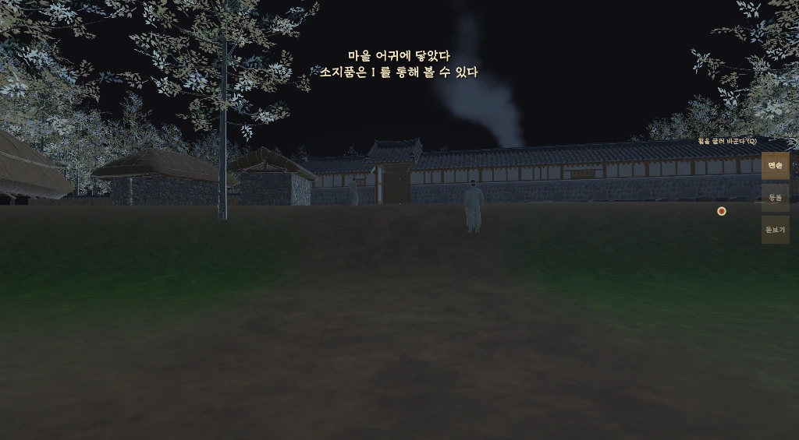<br>
  <sub>밤, 마을 어귀에 닿는다</sub>
</p>

| | |
|---|---|
| 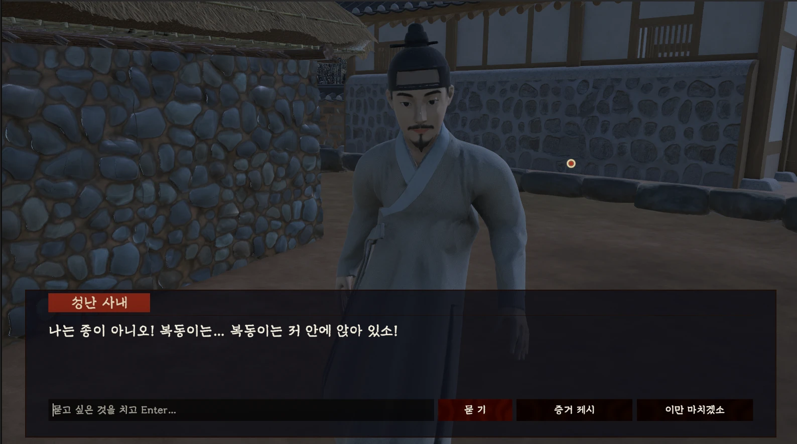 | 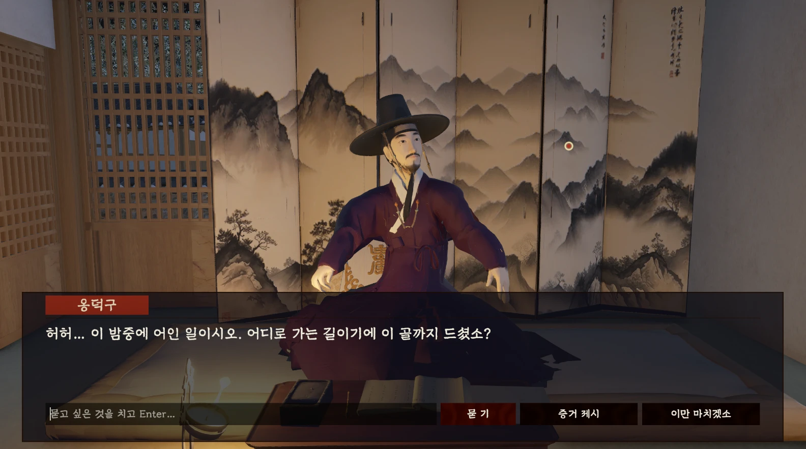 |
| 담 밖의 성난 사내는 「나는 종이 아니오」라고 외친다 | 집 안의 옹덕구는 나그네를 사랑방에 들인다 |

묻고 싶은 말은 **직접 쳐서** 묻는다. 대답은 AI가 인물의 성격대로 지어낸다.
주인이 자리를 뜨면 사랑방을 뒤질 수 있다.

| | |
|---|---|
| 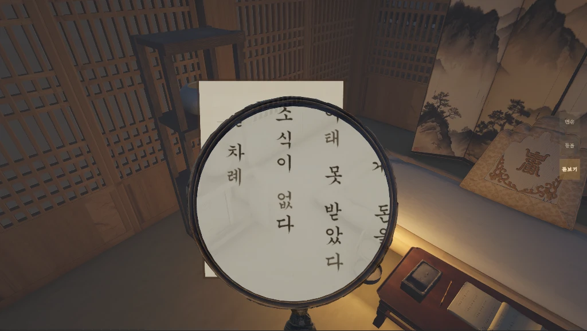 | 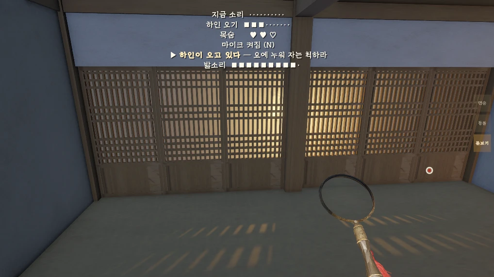 |
| 한자 문서에 돋보기를 대면 한글로 읽힌다 | 소리가 이어지면 하인이 온다. 요에 누워 자는 척해야 한다 |

씬: `Onggojip` + `Onggojip_마당` + `Onggojip_사랑방`

### 출도 또는 붙들림

| 길 | 조건 | 2막 첫 장면 |
|---|---|---|
| **출도** | 요에 누워 「출도하기」를 누른다 | 아전이 쩔쩔매며 어사를 맞는다 |
| **붙들림** | 잠행 중 목숨 셋을 다 잃는다 | 「자네는 누구길래…」 낮춤말을 듣다가 마패를 꺼내야 공손해진다 |

어느 길이든 2막으로 간다. **들켜도 처음부터 다시 하지 않는다.** 못 찾은 단서는 장계의 빈칸으로 남는다.

### 2막 · 아침 — 관아

신분이 드러나자 관아가 문을 연다. **찾을 것은 문서고, 물을 것은 동헌**이다.

| | |
|---|---|
| 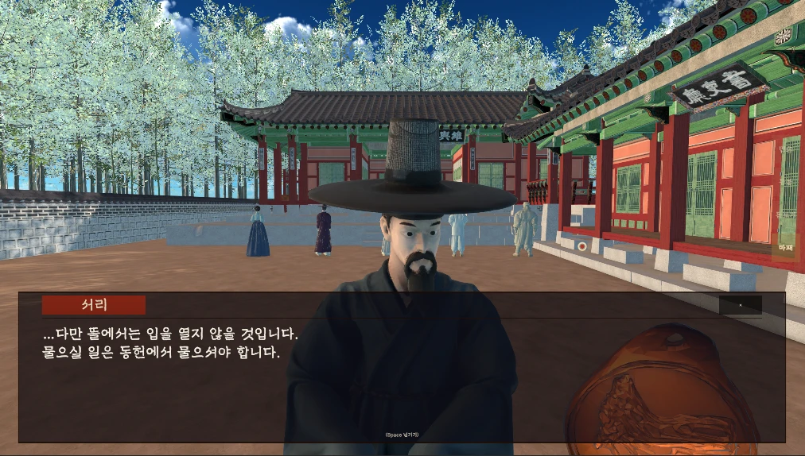 | 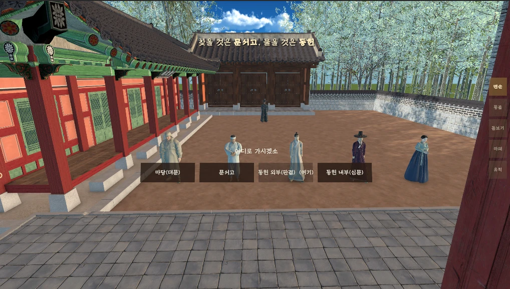 |
| 서리가 맞는다. 뜰에서는 아무도 입을 열지 않는다 | 뜰에 모인 사람들. 지도로 갈 곳을 고른다 |

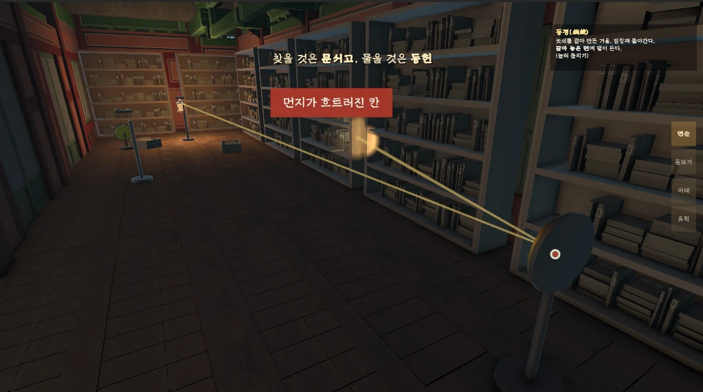
<sub>문서고 — 등경에 얹은 등불이 동경에 꺾여 서가로 간다. 맞는 칸에 앉으면 숨은 장이 떨어진다</sub>

| | |
|---|---|
| 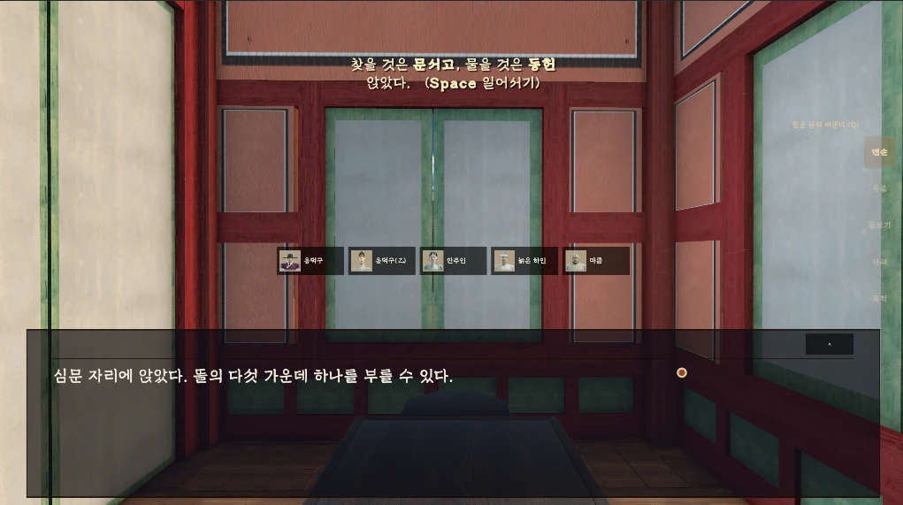 | 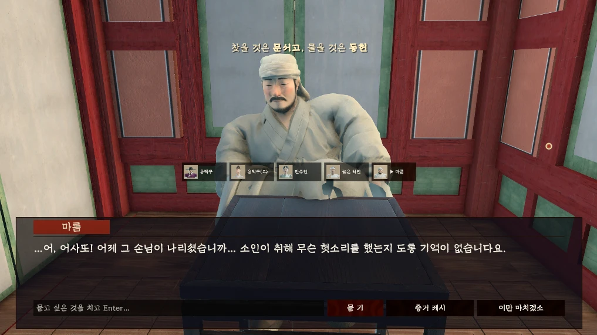 |
| 동헌 심문 자리에 앉으면 다섯 가운데 하나를 부를 수 있다 | 불려 온 마름이 「기억이 없다」며 몸을 사린다 |

씬: `Onggojip_Gwana`

### 끝 · 장계

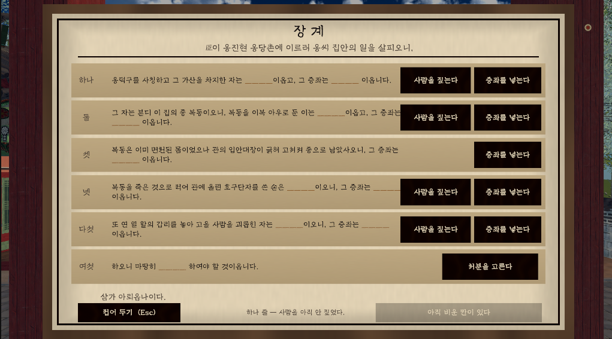
<sub>여섯 줄의 빈칸. 줄마다 사람을 짚고 증좌를 넣은 뒤, 마지막 줄에서 처분을 고르고 마패로 봉한다</sub>

봉하면 조사청으로 돌아와 걸어 나가며 끝난다.

---

## 등장인물

| | 인물 | 1막 | 2막 |
|:---:|---|---|---|
|  | **옹덕구** (甲)<br>집주인 | 나그네를 사랑방에 들이고 집 이야기를 한다 | 「나는 옹덕구요」로 대수롭지 않게 넘긴다 |
|  | **성난 사내** (乙)<br>담 밖의 사내 | 「나는 종이 아니오」라고 외친다 | 어사 앞이라 조리 있게 말한다 |
|  | **안주인**<br>옹덕구의 아내 | — | 발 뒤에서, 늙은 하인을 통해 짧게 말한다 |
|  | **늙은 하인**<br>오래된 종 | 밤에 소리를 듣고 살피러 온다 | 무언가에 매여 버틴다 |
|  | **마름**<br>소작을 맡은 자 | 취중에 무언가를 흘린다 | 겁에 질려 「기억이 없다」 |
| 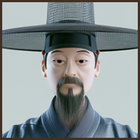 | **서리**<br>관아 아전 | — | 어사를 돕는다. 뜰에서는 아무도 입을 열지 않는다고 이른다 |
|  | **마을 사람** | 마을 어귀에서 소문을 들려준다 | — |

<sub>얼굴은 게임 안 부르기 판·장계에 쓰는 것과 같은 그림(`Resources/이문록_얼굴`)에서 잘랐다.</sub>

---

## 핵심 장치

### 잠행 — 소리와 들킴

주인이 방을 나가 문이 닫히면 조사가 열린다. 그때부터 내는 소리가 쌓인다.

- 서랍·병풍·보료·아궁이 재를 건드리고 뛰는 몸짓 소리에 **마이크 소리**가 합쳐진다
- 큰 소리 한 번보다 **계속 내는 소리**가 사람을 부른다
- 하인이 문 앞에 닿기 전에 요에 누우면 돌아간다. 못 누우면 목숨 하나를 잃는다(셋)
- 주인이 보는 앞에서는 물건을 뒤질 수 없다

수치와 얼개: [소리와_잠입](../소리와_잠입.md)


### 심문

- 심문은 동헌에서만 한다. 뜰에서는 아무도 입을 열지 않는다
- 대답은 Gemini가 인물의 성격 명세대로 지어낸다
- **무엇을 내밀어야 무엇을 실토하는지는 데이터가 정한다.** AI가 무슨 말을 해도 단서가 열리는 조건은 게임이 쥔다
- 수첩에서 증거를 골라 내밀면 태도가 단계별로 무너진다
- 「소매를 걷어라」 같은 명령도 있다. 근거가 없을 때는 단추가 흐리게 뜬다


### 도구

| 돋보기 | 마패 | 유척 | 등불 |
|---|---|---|---|
| 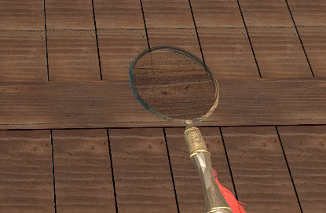 | 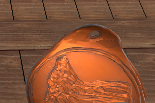 | 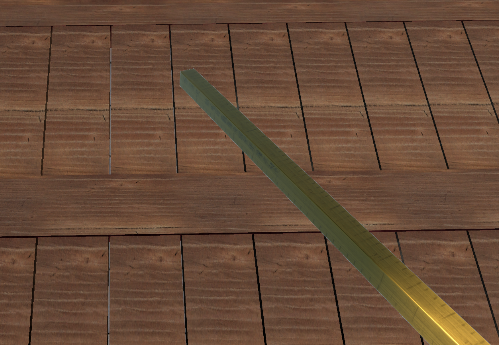 | 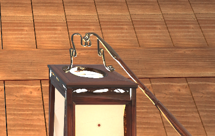 |
| 한자 문서를 한글로 읽는다 | 출도 · 신분 공개 · 장계 봉함 | 흉터를 재어 대장과 대조한다 | 지워진 글을 비춘다 |

### 문서고 — 등불과 거울

등경에 등불을 얹고 동경(구리 거울)을 15°씩 돌린다.
불빛이 거울에 꺾여 서가의 한 칸에 앉으면 숨은 장이 떨어진다.
불빛의 줄기는 눈에 보이게 그린다. 안 보이는 빛으로 맞히라 하면 제비뽑기가 되기 때문이다.


---

## 결말

장계는 여섯 줄이다. 줄마다 **사람 하나와 증좌 하나**를 고르고, 마지막 줄에서 처분을 고른다.
조사에서 캐낸 단서만 보기에 뜬다. 점수와 처분에 따라 **참 · 자비 · 반 · 헛** 네 끝으로 갈린다.

줄별 정답과 점수: [단서표 · 장계](제1사건_옹고집_단서표.md#장계)

---

## 조작

| 키 | 동작 |
|---|---|
| WASD · 마우스 | 걷기 · 둘러보기 |
| 좌클릭 | 바라보는 것을 집거나 연다 |
| E | 문 |
| 휠 · Q | 도구 바꾸기 (맨손 · 등불 · 돋보기 …) |
| F | 고른 도구를 든다 |
| I | 수첩 |
| M | 지도 (2막) |
| N | 마이크 끄기 |
| R | 심문 자리에서 사람 부르기 |
| H | 장계 할 일 다시 보기 (2막) |
| Space | 요·자리에서 일어서기 |
| Esc | 보던 판 내려놓기 |

---

## 기술 메모

| 무엇 | 어디 |
|---|---|
| 사건 진행 | `Onggojip/Scripts/OnggojipCase.cs` |
| 단서 표 · 출도 필수 단서 | `Onggojip/Scripts/OnggojipClues.cs` |
| 인물 | `Onggojip/Data/*_Interrogation.asset` |
| 장계 | `Onggojip/Data/장계_옹고집.asset` · `Scripts/Progression/VerdictReport.cs` |
| 잠행 | `Scripts/AI/` — `NoiseListener` · `NoiseWarning` · `ServantCheck` · `StealthLives` |
| 숨기 · 출도 | `Scripts/Player/HidePlace.cs` · `Scripts/Tools/RoyalWarrant.cs` |
| 한자/한글 문서 그림 | `Tools/DocBaker` |

**알려진 함정**

- 씬을 셋 다 열어야 제대로 보인다. `Onggojip_마당`만 열면 밤이 아니라 낮처럼 훤하다.
- `.asset`·`.unity` 안의 한글은 `\uXXXX`로 적혀 있어 그냥 검색하면 안 걸린다.
- 믹사모 걸음은 엉덩이뼈에 이동이 구워져 있다. `BakedTravel`을 붙여야 걷는다.
- 유니티 6에서 `Animator.speed` 음수는 0으로 깎인다. 거꾸로 돌리려면 상태 속도를 −1로.
- 화성행궁 에셋은 콜라이더가 비었거나 계단을 덮는 상자로 온다. 마루 높이 1.8345.
