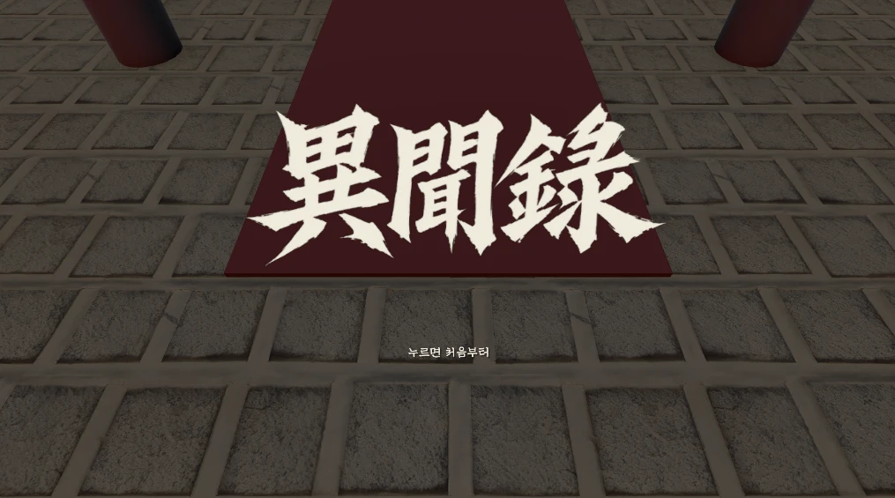

<p align="center">
  
</p>

<h1 align="center">이문록 異聞錄</h1>

<p align="center">
  설화 뒤에 묻힌 사실을 캐는 조선 암행 추리 게임
</p>

<p align="center">
  Unity 6 · URP · PC · Gemini NPC
</p>

---

## 소개

왕명을 받은 어사가 설화로 전해지는 세 사건을 조사한다.
사람을 심문하고 물증을 모아 진실을 밝힌 뒤, 그 진실을 그대로 고할지 정해 판결을 내린다.
세 판결의 경향에 따라 결말이 갈린다.

| 사건 | 모티브 | 문서 |
|---|---|---|
| 제1사건 | 옹고집전 | [Docs/사건/제1사건_옹고집.md](Docs/사건/제1사건_옹고집.md) |
| 제2사건 | 서천꽃밭 | [Docs/사건/제2사건_서천.md](Docs/사건/제2사건_서천.md) |
| 제3사건 | 견우직녀 | [Docs/사건/제3사건_견우.md](Docs/사건/제3사건_견우.md) |

## 개발 환경

| | |
|---|---|
| 엔진 | Unity 6000.3.19f1 |
| 렌더 파이프라인 | URP |
| 플랫폼 | PC (키보드 · 마우스) |
| NPC 대화 | Google Gemini API |

## 실행

1. 저장소를 클론한 뒤 git 으로 오가지 않는 아트 꾸러미를 받아 넣는다. 받는 법: [팀원_받는법](Docs/팀원_받는법.html)
2. 프로젝트 루트(`Assets` 옆)에 `gemini_api_key.txt` 를 만들고 API 키를 넣는다.
   키가 없으면 NPC 는 목업 대답기로 대답한다.
3. `Assets/_Project/Scenes/Core/IntroScene.unity` 를 열고 Play 한다.

## 프로젝트 구조

```
Assets/_Project/
├─ Scripts/       공통 코드 (IMUNROK.Common)
├─ Scenes/Core/   시작 · 조사청 · 엔딩 · 심문
├─ Onggojip/      제1사건
├─ Seocheon/      제2사건
└─ Gyeonu/        제3사건
Assets/IMUNROK_UI/  공통 UI 꾸러미
Tools/            에디터 밖 도구
Docs/             문서
```

## 문서

- [에셋 출처와 라이선스](Docs/에셋_출처와_라이선스.md)
- [에셋 어디에 두나](Docs/에셋_어디에_두나.md)

## 팀

**cerberus-team**

| 담당 | |
|---|---|
| 공통 · 제1사건 | SO0omin |
| 제2사건 | h-ns-l0 |
| 제3사건 | ryurujxx |
